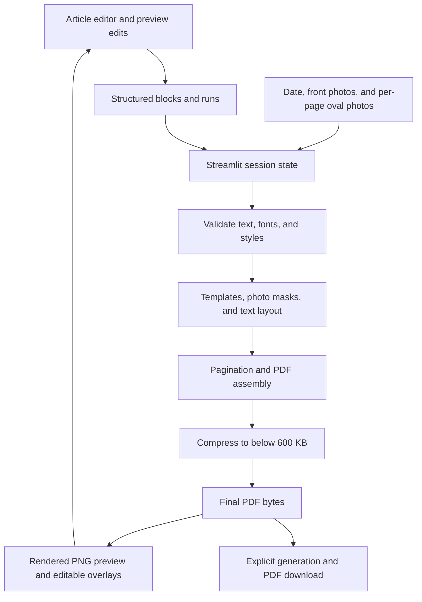

# PrimePDF — Tamil Magazine PDF Generator

PrimePDF turns a Tamil article, four optional front photos, and optional per-page oval photos into a magazine PDF using the supplied front and content-page templates. It includes an editable live PDF preview, automatic pagination, paragraph formatting, selected-character colors, photo cropping, and a strict export size limit below 600 KB.

**Deployed on Streamlit:** [primepdf.streamlit.app](https://primepdf.streamlit.app/)

**Source repository:** [github.com/praga-16/primepdf](https://github.com/praga-16/primepdf)
**Deployment entry point:** `app.py`
**Deployment branch:** `main`

The app does not require an AI API, API key, Node.js build, database, or external editor CDN. When run locally, PDF processing happens on your computer. In the hosted Streamlit app, article text and uploaded photos are processed by the hosting server.

## Contents

- [Features and scope](#features-and-scope)
- [Repository structure](#repository-structure)
- [Requirements](#requirements)
- [Local installation](#local-installation)
- [Using the application](#using-the-application)
- [Technical architecture](#technical-architecture)
- [Content data model](#content-data-model)
- [PDF layout and typography](#pdf-layout-and-typography)
- [Photo processing](#photo-processing)
- [600 KB export limit](#600-kb-export-limit)
- [Streamlit deployment](#streamlit-deployment)
- [Storage and session behavior](#storage-and-session-behavior)
- [Troubleshooting](#troubleshooting)
- [Verification and maintenance](#verification-and-maintenance)
- [Known limitations](#known-limitations)

## Features and scope

| Area | What the application handles |
| --- | --- |
| Article input | Plain-text paste, paragraph blocks, Tamil and supported Latin characters |
| Magazine layout | Original template artwork, front title, multiple content pages, protected lower photo area |
| Preview | PNG renders of the actual compressed PDF; automatic or on-demand refresh |
| Editing on the preview | Double-click a text block to change its source text; reflow after the edit |
| Text formatting | Headings, subheadings, bold, bullets, numbered lists, left/center/justified paragraph alignment |
| Font size | Paragraph/heading sizes from 8 to 96 pt, with title auto-fitting inside its available area |
| Text color | Color selected words or punctuation; with no character selection, color the paragraph/heading |
| Numbered subheadings | Keep the visible number when a numbered item is converted to a subheading |
| Explicit line breaks | Shift+Enter or LINE BREAK; front titles may span three or more lines if they fit |
| Dates and page numbers | Tamil month names; visible-ink centering in the content-page header |
| Photos | Four front uploads plus an optional oval upload for each content page; independent crop, zoom, horizontal movement, and vertical movement inside fixed frames |
| Export | Download the same PDF bytes used for the successful preview; files strictly below 600,000 bytes |

This is a generator for this magazine design. It does not import arbitrary PDFs for editing, provide free dragging of template elements, or create article text with AI.

## Repository structure

The Git repository contains these runtime and documentation files:

```text
primepdf/
├── .gitignore
├── README.md
├── app.py
├── photos.py
├── requirements.txt
├── editor/
│   └── index.html
├── assets/
│   ├── publication.png
│   ├── photo-geometry.json
│   ├── photo-left-mask.png
│   ├── photo-center-mask.png
│   ├── photo-right-mask.png
│   └── photo-small-mask.png
├── fonts/
│   ├── TAM-Tamil013 Normal.ttf
│   └── Uni Ila.Sundaram-01.ttf.orig
└── templates/
    ├── only front.pdf
    └── blank_front_template_no_date_no_photo.pdf
```

| File or directory | Responsibility |
| --- | --- |
| `app.py` | Streamlit UI, input validation, fonts, Tamil conversion, text layout, pagination, headers, PDF compression, preview rendering, downloads |
| `photos.py` | EXIF orientation, image cropping, perspective transforms, photo masks, and photo placement |
| `editor/index.html` | Custom Streamlit component containing the source editor, toolbar, rendered-page preview, and editable text overlays |
| `requirements.txt` | Python dependency ranges used by local installation and Streamlit deployment |
| `assets/publication.png` | Fixed publication artwork in the content-page header |
| `assets/photo-geometry.json` | Front photo rectangles and perspective corner coordinates in PDF points |
| `assets/photo-*-mask.png` | Alpha masks limiting uploaded images to the four front-frame interiors |
| `fonts/` | Supplied Unicode body/subheading fallback font and legacy TAM title font |
| `templates/only front.pdf` | Front-page background template |
| `templates/blank_front_template_no_date_no_photo.pdf` | Reused content-page background template |
| `.gitignore` | Excludes generated outputs, caches, backups, reference files, local tests, and secrets |

The app creates these files/directories when needed; they are **not committed**:

```text
assets/body-bold.ttf       # Generated font asset for synthetic bold rendering
assets/body-bold.source    # Source-font identity used to refresh that asset
output/                   # PDFs saved by explicit generation
```

Local development can also contain `tests/`, `tools/`, `tmp/`, `requirements-dev.txt`, `full.pdf`, and earlier app backups. Those files are excluded from this minimal runtime repository. The reference `full.pdf` is not required to run the application.

Keep the committed directory structure and filenames intact. Paths are resolved relative to `app.py` and `photos.py`, rather than relying on `D:\pdf` on the deployed server.

## Requirements

Python **3.11 is the tested development version**. Use a modern browser with JavaScript enabled. The deployment must allow the application to write its generated bold-font assets and output PDFs.

| Python package | Required range | Used for |
| --- | --- | --- |
| `streamlit` | `>=1.35,<2` | UI, session state, uploads, custom component hosting, downloads |
| `PyMuPDF` | `>=1.28,<2` | PDF templates, Story text shaping/layout, rendering, image rewriting, font subsetting |
| `fonttools` | `>=4.50,<5` | Font coverage checks and generated bold-font asset |
| `tzdata` | `>=2024.1` | Time-zone data, including Windows installations |
| `Pillow` | `>=10.3,<13` | Image decoding, orientation, resampling, transforms, alpha masks |
| `numpy` | `>=1.24,<3` | Perspective transform calculations and mask geometry |

PyMuPDF is imported as `fitz`. Install `PyMuPDF` through the requirements file; a separate package named `fitz` is not needed. Version 1.28 or newer is required for the implemented image-compression path.

The application does not require Poppler, Ghostscript, an office suite, Playwright, or Node.js to run. Browser automation tools were used only for development checks.

## Local installation

### Clone and install

```powershell
git clone https://github.com/praga-16/primepdf.git
cd primepdf
python -m venv .venv
.\.venv\Scripts\Activate.ps1
python -m pip install --upgrade pip
python -m pip install -r requirements.txt
python -m streamlit run app.py
```

Open the URL printed by Streamlit, normally [localhost:8501](http://localhost:8501).

If PowerShell activation is unavailable, run the virtual environment directly:

```powershell
.\.venv\Scripts\python.exe -m pip install -r requirements.txt
.\.venv\Scripts\python.exe -m streamlit run app.py
```

For Linux/macOS, activate the environment with `source .venv/bin/activate`; the installation and launch commands are otherwise the same.

### Existing installation at `D:\pdf`

```powershell
cd D:\pdf
git pull origin main
python -m pip install -r requirements.txt
python -m streamlit run app.py
```

Stop an already running Streamlit process before restarting it, then refresh the browser. Updating dependencies is necessary after the compression upgrade.

## Using the application

1. Choose the issue date. The default date uses `Asia/Kolkata`.
2. Upload any of the four front photos. After pasting an article, the **Oval photos** sidebar's **Page uploads (optional)** accordion shows one optional upload for each content page. A ten-page PDF has nine oval upload boxes, labeled Page 2 through Page 10. Leave a box empty or disable **Show photo** to keep that page's oval blank. Select **Oval page** to adjust that page's zoom and crop in the sidebar while viewing the preview; each page retains its own settings when you switch pages.
3. Open **Image movement / crop controls**, select a photo tab, and adjust its image inside the existing frame.
4. Paste the article into the Article editor. Paste handling uses plain text; source HTML formatting is not imported. Lines starting with a bullet marker or a numeric marker such as `1.` are recognized as list content.
5. The first block marked **HEADING** becomes the front title. If none is marked, the first nonempty content block is used. The chosen title is removed from the body flow.
6. Select a paragraph or heading and use the toolbar for its block type, alignment, or size. Enter a size and click **APPLY SIZE**.
7. To color a single word or full stop, select those characters, choose the color, and click **APPLY COLOR**. With no characters selected, the color applies to the paragraph/heading.
8. Review the live pages. Turn **Auto preview refresh** off to make several edits without rendering a PDF after every change, then click **REFRESH PREVIEW** once. Manual mode also defers recalculating content-page upload boxes until refresh. Turn auto refresh on to resume automatic updates. Double-click a text overlay to edit that source block directly from the PDF preview. Use **Shift+Enter** or **LINE BREAK** for an explicit newline. Press **Escape** or click outside the edit area to finish. Outdated preview text overlays are disabled until refreshed.
9. Click **GENERATE PDF**, check the displayed file size, then **DOWNLOAD PDF**.

Changing content, date, or photo settings invalidates the previous download. Generate again after the preview updates. **GENERATE PDF** refreshes an outdated preview before exporting, including in manual mode. **CLEAR** removes formatting and restores ordinary body text; it is not a delete-content button.

## Technical architecture



### Frontend component

`editor/index.html` is served through `streamlit.components.v1.declare_component`. It contains its own HTML, CSS, and JavaScript, with no frontend build pipeline.

The source editor uses `contenteditable`. Formatting and selections are serialized into structured blocks instead of sending arbitrary editor HTML to the PDF renderer. Text runs preserve bold and inline color. Plain-text paste is parsed into paragraphs and lists.

The component sends content, a revision identifier, and an optional generation request to Python with the Streamlit component message protocol. Editing is debounced by approximately **400 ms**. A revision match controls acceptance of preview responses; pending text overlays are disabled while the preview updates.

The Python-rendered PNG pages are displayed alongside hit regions derived from PDF placement metadata. A hit region carries the source block index and its page rectangle. Editing a hit region changes the original block, then regenerates the layout. A paragraph split across pages is still one source block; editing a fragment affects that full block.

### Backend pipeline

| Entry point | Purpose |
| --- | --- |
| `main()` | Build Streamlit controls and coordinate component/session updates |
| `clean_blocks()` | Validate block types, sizes, colors, alignments, and normalized text |
| `font_paths()` / `validate_text()` | Choose complete fonts and check character coverage |
| `unicode_to_tam()` | Convert Tamil title text into the supplied legacy TAM font encoding |
| `make_story()` | Create a shaped, styled PyMuPDF Story for a body block |
| `title_layout()` / `draw_title()` | Fit and center the front title, including run colors |
| `draw_header()` | Add the Tamil date, page number, and publication artwork |
| `generate_pdf()` | Assemble the front and paginated content pages |
| `compact_pdf()` | Enforce the export byte limit |
| `preview_pages()` | Render the final bytes into preview images at 1.4× PDF-point resolution |
| `blank_preview()` | Show template/photo previews before an article is provided |
| `prepared_photo()` / `draw_photos()` | Prepare and place masked uploaded images |

The preview fingerprint includes the article, issue date, crop settings, upload content hashes, and compression-version marker. An unchanged fingerprint reuses the current generation result. An explicit generation request saves and exposes that result's already compressed bytes, so preview and download use the same rendering.

## Content data model

An article is a list of blocks. A simplified example:

```json
[
  {
    "type": "heading",
    "text": "Magazine title",
    "align": "center",
    "font_size": 36,
    "runs": [{"text": "Magazine title", "bold": false}]
  },
  {
    "type": "body",
    "text": "One word.",
    "align": "justify",
    "runs": [
      {"text": "One ", "bold": false},
      {"text": "word", "bold": true, "color": "#cc1144"},
      {"text": ".", "bold": false}
    ]
  }
]
```

| Field | Meaning |
| --- | --- |
| `type` | `heading`, `subheading`, `body`, `bullet`, or `number` |
| `text` | Concatenated run text; when runs exist, their text is authoritative during validation |
| `runs` | Text fragments with `text`, `bold`, and optional inline `color` |
| `align` | `left`, `center`, or `justify` |
| `font_size` | Optional block size in points; validated between 8 and 96 |
| `color` | Optional whole-block `#rrggbb` color; an inline run color takes precedence |
| `number` | Numbered-list marker, starting at a minimum of 1 |
| `source_index` | Added by the backend to map rendered placements back to the input block |

Colors must be six-digit hexadecimal values. Text is HTML-escaped before Story rendering. Text is normalized to NFC, and unsupported curly quote variants are converted to straight quotes compatible with the supplied font.

The generation result contains PDF `data`, `page_count`, font notices, placement metadata, and an optional saved `path`. This is an internal Python model, not a public HTTP API.

## PDF layout and typography

Coordinates use PDF points: **72 pt = 1 inch**, with rectangles represented as `[x0, y0, x1, y1]` in PyMuPDF page coordinates.

| Setting | Current value |
| --- | --- |
| Output page | Approximately `595.20 × 841.92 pt` |
| Body content rectangle | `[14.0, 61.2, 581.2, 539.0]` |
| Front title rectangle | `[24.0, 626.0, 571.2, 810.0]` |
| Date rectangle | `[1.5, 21.0, 147.5, 49.0]` |
| Page-number rectangle | `[497.0, 21.0, 592.0, 49.0]` |
| Default body size / line advance | `22 pt / 35.001 pt` |
| Default subheading size | Approximately `24 pt` |
| Default front title size / line advance | `42 pt / 60 pt` |
| Default subheading blue | `#20429B` |
| Bullet brown | `#9F4932` |

The content template is transformed into the reference output page size. Template artwork remains the background; content flows only through the body rectangle, protecting the lower oval-photo area.

PyMuPDF Story shapes Unicode body/subheading text and paginates overflowing paragraphs. Heading placement attempts to keep the heading with at least the first line of the following block when that combination fits. Lists use hanging indentation, and default body alignment is justified.

The front title uses the supplied legacy **TAM-Tamil013** font through Unicode-to-TAM conversion. Supported Latin title segments use the supplied Unicode font. The title retains explicit line breaks, wraps when needed, and fits by reducing the chosen upper-bound size. With default settings, it tries 42 down to 24 pt. A title that cannot fit reports an error.

Content headers begin at **Page-2**. The front template does not receive a date or page-number header. Dates and numbers are centered using the rendered visible-ink bounds.

### Fonts and fallback behavior

The supplied complete `Uni Ila.Sundaram-01.ttf.orig` is the Unicode fallback. Its `.orig` suffix is accepted; it is a font asset, not an app backup. A complete `Uni Ila.Sundaram-01.ttf` is also accepted if supplied under that filename.

Optional complete fonts can be added at these exact paths:

```text
fonts/Uni Ila.Sundaram-03.ttf
fonts/TAM-Tamil006 Normal.ttf
```

The backend uses them for body/subheading text after completeness checks. Incomplete embedded PDF font subsets are unsuitable for arbitrary new articles. Without those complete originals, font weights and widths can differ from the visual reference. The **Font information** expander explains the active fallback.

Synthetic bold uses the selected body font's outlines through a generated font asset and PDF drawing treatment. It is not a separate supplied bold typeface. Missing glyphs produce an explicit error instead of silent font substitution.

## Photo processing

| Slot key | Upload label | Placement |
| --- | --- | --- |
| `left` | Front left photo | Tilted left frame |
| `center` | Front center photo | Tall middle frame |
| `right` | Front right photo | Tilted right frame |
| `small` | Small front photo | Shaped frame below the middle frame |
| `oval` | Page N oval photo (optional) | Bottom oval on that specific content page only |

Accepted extensions are PNG, JPG/JPEG, and WebP. Each uploaded file is checked against **25 × 1024 × 1024 bytes** before image processing. EXIF orientation is applied, and the image is converted to RGB.

All front slots and each page's oval have independent controls:

- Zoom: **1.00–3.00**, step **0.05**.
- Horizontal pan: **−1.00–1.00**, step **0.05**.
- Vertical pan: **−1.00–1.00**, step **0.05**.

Controls affect the crop inside a fixed frame. They do not move frame borders or change template geometry. Movement along an axis can be limited at 1× zoom when the image already fills that axis; zooming in creates more crop room.

The `cover()` operation selects a crop matching the frame aspect ratio. Front large frames use perspective transforms solved with NumPy; masks clip their curved/tilted interiors. The small front frame uses its supplied mask. The content oval mask is generated dynamically; its rectangle is `[130, 565, 467, 789]` in `photos.py`.

Prepared photos are cached in memory with an LRU cache of **24 entries**, keyed by slot, upload bytes, and crop settings. Photos are initially prepared at template-resolution dimensions; final PDF compression may reduce their resolution.

Content-page upload boxes are derived from the current article's pagination. Uploading, hiding, or cropping photos does not change the number of pages. Each oval has a **Show photo** checkbox; turning it off keeps the upload available but excludes it from the preview and export. Assignments follow printed page numbers, so review them after editing text that changes pagination. Boxes for pages removed by an article edit disappear.

The generator accepts `oval_photos` and `oval_crops` dictionaries keyed by printed page number (2 for the first content page). An empty `oval_photos` dictionary leaves every content oval blank. The application uses this per-page mode; the older shared-oval generator argument remains available for compatibility with existing local callers.

## 600 KB export limit

The limit is strict: **PDF byte length must be less than 600,000**. This uses decimal KB, rather than a 600 KiB threshold.

`compact_pdf()` applies these stages:

1. Remove unused/duplicate PDF objects and deflate streams. Return immediately if the output already fits.
2. Subset embedded fonts and enable compressed PDF object streams. Return if it now fits.
3. Try progressively stronger image rewriting. Each candidate starts from the same font-subset document, avoiding repeated recompression of earlier candidates.

| Attempt | Image target DPI | JPEG quality setting |
| --- | --- | --- |
| 1 | 150 | 82 |
| 2 | 120 | 72 |
| 3 | 100 | 60 |
| 4 | 85 | 45 |
| 5 | 70 | 30 |
| 6 | 50 | 18 |

The first candidate below the limit is used. Text remains vector/font-based; pages are not flattened into screenshots. The small publication-header artwork is restored from its original lossless asset after image rewriting, preventing repeated downsampling across content pages. Photo detail can decrease when stronger compression is needed. Preview PNGs are rendered from the final compressed bytes, so the preview reflects that quality.

If all attempts fail, generation stops with an edit prompt instead of making an oversized download available. Large page counts or very complex content can exceed the limit even after image compression.

A development check reduced an existing eight-page PDF from **4,422,786 bytes to 576,377 bytes**, preserving its page count and extracted text. This is a measured example, not a fixed compression ratio for every article.

## Streamlit deployment

The project's supplied deployment URL is [https://primepdf.streamlit.app/](https://primepdf.streamlit.app/).

Use these coordinates when configuring or recreating the Community Cloud deployment:

| Setting | Value |
| --- | --- |
| Repository | `praga-16/primepdf` |
| Branch | `main` |
| Main file path | `app.py` |
| Dependency file | Root `requirements.txt` |
| Python | 3.11 is the tested development baseline; choose a supported host version with compatible package wheels |
| Secrets | None required by the current implementation |

Community Cloud deployment selects a repository, branch, and entry-point path. Keep `requirements.txt` at the repository root and include all fonts, templates, editor files, and assets. See the official [deployment guide](https://docs.streamlit.io/deploy/streamlit-community-cloud/deploy-your-app/deploy) and [dependency guidance](https://docs.streamlit.io/deploy/streamlit-community-cloud/deploy-your-app/app-dependencies).

The repository does not currently contain a Dockerfile, persistent-storage setup, authentication layer, CI workflow, or `.streamlit/config.toml`. Python-version selection and hosting configuration are managed outside this repository.

After publishing a change, check the deployed build logs, particularly after modifying requirements. Confirm `PyMuPDF >= 1.28` is installed, then test article input, all photo uploads, preview editing, and download size. This README records the deployment URL provided by the project owner; it does not certify current service uptime or the exact revision running on the host.

## Storage and session behavior

- Article blocks, preview results, upload widgets, and generation state are maintained through the browser component and Streamlit session state.
- Normal date or photo updates reuse the current article in the same session. There is no durable draft database or automatic recovery system.
- Preview updates do not write a PDF to `output/`. Explicit generation writes `tamil_magazine_YYYYMMDD_<unique-id>.pdf` and exposes the bytes for downloading.
- Runtime outputs and font caches are ignored by Git. Existing generated files are not automatically deleted; operators should manage local output accumulation.
- Server output files should not be treated as permanent storage on a hosted deployment. Download completed PDFs to keep a durable copy.
- The app has no accounts, custom access controls, or application-level retention policy. The current code does not call an AI service or third-party article-processing API. Hosted use still sends inputs to the Streamlit server.

## Troubleshooting

| Symptom | Likely cause / action |
| --- | --- |
| Missing font/template/mask | Restore the committed folders and exact filenames; on Linux, filename case matters |
| Complete Unicode Sundaram font required | Confirm the supplied `.ttf.orig` font is present and is a complete font file |
| Unsupported-character error | Remove/replace the reported characters or supply a compatible complete font; curly quotes are normalized automatically |
| Sundaram-03 / Tamil006 warning | Informational fallback notice; supplied Sundaram-01 is used until complete originals are added |
| Title is too long | Shorten it, adjust explicit line breaks, or lower its size; the title must remain inside its fixed area |
| A block cannot fit in the locked content region | Reduce the oversized block's size or simplify its content |
| Cannot fit under 600 KB | Shorten the article or use simpler photos; stronger photo compression has already been attempted |
| `rewrite_images` missing | Install the current requirements and restart; older PyMuPDF versions do not support this export path |
| Preview/download reflects an old installation | Restart Streamlit, refresh the browser, and check that the deployed branch/build uses the latest commit |
| Download disappears after editing | Expected: the old generation is invalidated; wait for preview refresh and generate again |
| Photo movement has little effect | Upload that slot first, then increase zoom if the existing crop leaves no room on the chosen axis |
| Image too large | Use an upload smaller than the application limit of 25 MiB per photo |
| Port 8501 is occupied | Stop the other process or run `python -m streamlit run app.py --server.port 8502` |
| Permission error creating files | Make the project `assets/` and generated `output/` locations writable by the app process |
| Draft disappeared after a session restart | Drafts are not durably saved; keep a separate source article copy |

## Verification and maintenance

### Runtime smoke check

From a fresh clone, install requirements and launch the app. Then:

1. Paste a title and several Tamil paragraphs, including a numbered item.
2. Convert the numbered item to SUBHEADING and confirm its number remains visible.
3. Select one word and a full stop separately; apply color and confirm only each selection changes.
4. Change a paragraph size, align a paragraph, and add a title line break.
5. Upload the four front photos and different oval photos on selected content pages. Exercise their crop controls, hide one oval, and confirm unassigned content pages stay blank.
6. Change the date and confirm the article remains in the same session.
7. Generate and download; confirm byte length is below 600,000 and review every page.

A command-line generator check is also possible:

```python
from datetime import date
import app

result = app.generate_pdf(
    [
        {"type": "heading", "text": "Sample title"},
        {"type": "body", "text": "Sample body text."},
    ],
    date(2026, 10, 15),
    save=False,
)
assert len(result.data) < app.MAX_PDF_BYTES
print(result.page_count, len(result.data))
```

The original development workspace contains 16 automated PDF tests plus browser checks for editing, selected colors, and preview/export behavior. Tests and their development dependencies are excluded from this runtime repository, so a fresh clone cannot run that local test suite without receiving those files separately. The tests were run locally; no automated GitHub CI is configured.

When changing layout, review both the front and every content page. Changes to geometry must stay consistent with masks and template artwork. When changing the renderer or compression, update the preview fingerprint's version marker so existing session caches are regenerated.

Keep commits focused on required source and assets. Avoid `git add .` when the development folder contains outputs or backups. For a README-only update, use:

```powershell
git add README.md
git commit -m "Document PrimePDF architecture and deployment"
git push origin main
```

## Known limitations

- Font size is a block-level control. Selected-character font sizes are not implemented; selected-character colors are supported.
- Front-title Tamil uses a legacy font encoding. Its appearance is supported, but Unicode search/copy extraction of that title may differ from the Unicode body text.
- Font availability limits exact matching to the original reference design. The flattened reference PDF and its incomplete embedded subsets cannot replace complete original fonts.
- A preview edit is a source-text edit followed by reflow. It is not an arbitrary PDF editor or a free-position text designer.
- Template borders, header locations, photo frames, and page dimensions remain fixed.
- Strong compression can visibly reduce image detail; an unlimited-length document cannot always fit below 600 KB.
- Large articles and high-resolution images can use substantial server memory and CPU during generation and preview rendering. There is no background task queue or explicit article-length cap.
- Dependency ranges are maintained in `requirements.txt`; there is no fully pinned lockfile, so environments can resolve different compatible package versions.
- No redistribution license is included in the repository. Supplied font and template assets remain subject to their respective owners' permissions.
# Additional magazine templates

The **Magazine template** selector keeps **Original magazine** as its default and
also offers Children / toys (Blank), Fabric / flowers (Blank 1), Blue geometric
(Blank 2), and Cream / teal (Blank 3). The original renderer and its four front
photo slots remain available. The four new layouts use one optional cover photo
and independent optional content-page photos in the sidebar. All photo areas
start blank; the supplied reference photographs and article text are not bundled.
Movement and zoom controls crop each upload inside its template's fixed frame.
The children and blue layouts alternate their right and left content-photo
positions. Each content page has one logical article area between the header and footer.
Paragraphs automatically wrap beside and below the template photo/frame, then
continue onto the next page. Photo areas remain protected even when an upload
is empty. Wrapping does not split the source paragraph into separate blocks.
Background flowers remain available for text. Select the template before editing;
when Auto preview refresh is off, use REFRESH PREVIEW after changing templates.

`template_layouts.py` contains the template catalog, title bounds, header/footer
positions, photo insertion, and continuous full-page pagination. `assets/templates/`
contains ten cleaned background JPEGs and their corresponding photo-mask PNGs
prepared from the supplied `Blank.pdf`, `Blank 1.pdf`, `Blank 2.pdf`, and
`Blank 3.pdf` designs. Their example headings and dates are reference-only and
are replaced by the editor title and selected date. The large cover slots follow
the supplied stepped, tilted, rectangular, or rounded shapes;
these files are required at deployment. No additional dependencies or API keys
are needed. The new layouts use the supplied complete Sundaram-01 font for
shaped Tamil text, including titles; their lettering can differ from the
reference PDFs' embedded fonts. Rich text colors, font size, manual line breaks,
editable PDF previews, optional per-page photos, and the strict 600,000-byte
export limit also apply to the added templates. Preview edit bounds follow each
template's actual text regions.
